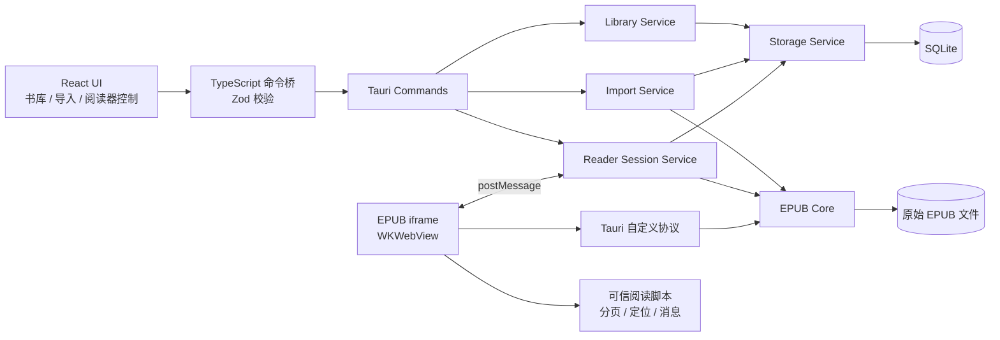
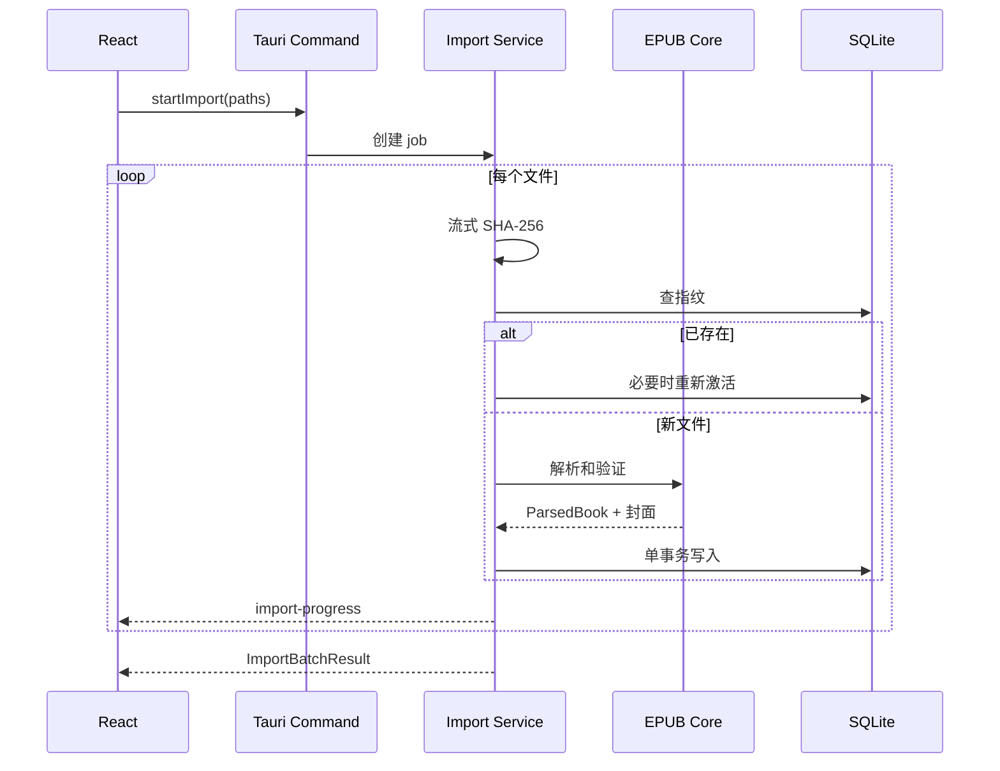

# Qurner 个人电子书阅读器软件设计说明书（SDS）

**文档版本：** 0.11-draft  
**文档状态：** 架构草案，待确认后作为 MVP 实现基线  
**适用需求：** `SRS.md` 0.3-draft  
**目标平台：** macOS 14 及以上，Apple Silicon  
**产品名称：** Qurner  
**Bundle Identifier：** `com.qurner.reader`

---

# 1. 设计目标

本设计只承诺实现 SRS 中标记为 P0 的 MVP，并为 P1、P2 保留清晰扩展边界。

设计优先级依次为：

1. 不修改原始电子书文件，不丢失个人阅读数据。
2. EPUB 阅读链路稳定，包括目录、分页、滚动、进度和书签。
3. 离线优先，MVP 不产生任何网络请求。
4. 核心模块可独立测试，能够由 DeepSeek harness 通过 CLI 持续开发和验证。
5. 避免为尚不存在的 V1.x、V2.x 功能提前引入复杂抽象。

MVP 不实现高亮、批注、TXT、PDF、收藏夹、文件重定位、备份恢复、自动更新和云同步。

---

# 2. 技术选型

## 2.1 核心决策

| 领域 | 选型 | 决策理由 |
|---|---|---|
| 桌面框架 | Tauri 2.x stable | macOS 桌面端使用系统 WKWebView，安装包和内存开销低于 Electron；支持 CLI 构建和 Rust 单元测试 |
| 后端语言 | Rust，Edition 2024 | 文件、ZIP、哈希、SQLite 和解析逻辑有明确所有权与错误类型，便于稳定测试 |
| 前端语言 | TypeScript | 与 React 配合，桥接协议可用 Zod 做运行时校验 |
| UI 框架 | React 19 | 书库、导入流程和阅读器控制界面适合组件化开发 |
| EPUB 渲染 | WKWebView iframe + 自研受控阅读脚本 | 保留原书 HTML/CSS，同时阻断书内脚本和远程请求 |
| 阅读资源加载 | Tauri 自定义协议，从原始 ZIP 按需读取 | 不复制整本书，不向本地 HTTP 服务暴露文件 |
| 数据存储 | SQLite + `rusqlite` | 支持事务、索引、版本迁移和 1,000 本书规模，无云依赖 |
| ZIP 读取 | Rust `zip` crate | 直接读取 EPUB 中央目录和单个资源，适合 100 MB 文件 |
| EPUB 语义解析 | `rbook = 0.7.13`，关闭默认写功能 | 复用 EPUB2/3 metadata、manifest、spine、TOC 和按需资源读取，避免重复实现 OPF/NCX/nav |
| XML 解析 | `quick-xml` | 解析 `container.xml`、OPF 和 NCX，不解析外部实体 |
| HTML 重写与清洗 | `lol_html` | 注入阅读脚本和 CSP nonce，阻断脚本与非本地资源 |
| 内容指纹 | SHA-256，Rust `sha2` | 与 SRS 的字节级判重规则一致，可流式计算 |
| Unicode 排序 | `icu_collator 2.4.0` compiled data | 不依赖系统 ICU，为中文和英文书名/作者生成确定性排序键 |
| 前端数据请求 | TanStack Query | 管理命令结果、缓存、失效和异步状态 |
| 阅读器临时状态 | Zustand | 管理当前章节、页状态、侧栏和瞬时 UI 状态 |
| 路由 | React Router | 区分书库、阅读器及未来的书籍详情 |
| 前端校验 | Zod | 校验所有 Tauri 命令和 iframe 消息 |
| Rust 测试 | 标准测试框架 + `tempfile` | 覆盖解析、存储、指纹和错误分支 |
| 前端测试 | Vitest + React Testing Library | 组件和状态测试 |
| Web 集成测试 | Playwright WebKit | 在真实 WebKit 语义下测试阅读脚本、分页和消息桥 |
| 包管理 | npm，提交 `package-lock.json` | 当前环境已安装，减少额外工具链 |
| Rust 依赖锁定 | 提交 `Cargo.lock` | 固定可复现的依赖版本 |

## 2.2 未采用的方案

- 不采用 Electron：安装包和内存占用更高，与轻量阅读器的定位不符。
- 不采用 SwiftUI 作为 MVP 主框架：本机没有完整 Xcode，CLI 构建、界面测试和依赖管理对当前 AI 开发流程成本更高。macOS WebView 仍是最终阅读渲染层，因此该选择不会改变 EPUB 的浏览器渲染特性。
- 不采用 Readium Swift Toolkit：会引入大型原生阅读框架，并为当前 MVP 增加不必要的格式与导航抽象。
- 不采用 epub.js 作为主引擎：需要把整本压缩包带入 JavaScript，或额外实现资源适配；自研 Rust 清单解析加小型阅读脚本更容易控制内存、安全和位置模型。
- 不采用 Tauri 3 alpha：只使用 stable major version，避免 alpha 破坏 API。
- 不采用 SwiftData、Core Data 或 JSON 文件作为主存储：SQLite 的迁移、事务和查询行为更可控。

## 2.3 环境与版本策略

- 当前机器已具备 macOS 26.6、Apple M5、Command Line Tools、Node.js 26.13.0 和 npm 11.20.0。
- 当前机器未安装 Rust，项目初始化前需通过 `rustup` 安装 stable toolchain。
- Tauri 桌面开发按官方要求使用 Xcode Command Line Tools；本项目不进行 iOS 开发。
- 使用 Tauri 2.x stable；升级 major version 前必须记录 ADR 并重新验证构建、协议和打包。
- Rust、npm 依赖版本由锁文件固定；设计文档只声明 major 版本，避免文档中的补丁版本与现实锁文件漂移。
- 前端目标为 `node >= 26 < 27`，以当前机器实际环境为开发基线。

---

# 3. 总体架构



系统是单一 macOS 应用，不包含后台服务器。Tauri 前端和后端通过命令与事件通信；EPUB 正文运行在隔离 iframe 中，阅读脚本只暴露有限消息协议。

---

# 4. 工程结构

```text
qurner/
├── SRS.md
├── SDS.md
├── DEVELOPMENT_PLAN.md
├── AI_COLLABORATION.md
├── AGENTS.md
├── package.json
├── package-lock.json
├── Cargo.toml                  # Rust workspace
├── Cargo.lock
├── src/                        # React + TypeScript 应用
│   ├── app/                    # 启动、路由、全局错误边界
│   ├── bridge/                 # Tauri invoke、事件订阅、Zod schema
│   ├── features/
│   │   ├── import/
│   │   ├── library/
│   │   └── reader/
│   ├── shared/                 # 通用 UI、格式化、样式变量
│   └── reader-engine/          # 注入 iframe 的 TypeScript
├── src-tauri/
│   ├── Cargo.toml
│   ├── tauri.conf.json
│   ├── capabilities/
│   ├── icons/
│   ├── resources/              # 编译后的阅读脚本
│   └── src/
│       ├── main.rs
│       ├── commands/
│       ├── protocol/
│       ├── services/
│       ├── session/
│       └── state.rs
├── crates/
│   ├── epub-core/              # ZIP、OPF、TOC、元数据、资源与指纹
│   │   └── tests/support/      # Rust EPUB 夹具生成器
│   ├── storage-core/           # SQLite、迁移、Repository
│   ├── library-core/           # 导入、书库等应用用例
│   └── reader-model/           # Locator、进度、设置和 DTO
├── fixtures/
│   ├── epub/
│   ├── expected/
│   └── performance/
├── scripts/
│   ├── benchmark-import.sh
│   └── verify-srs-traceability.sh
└── docs/
    ├── decisions/              # ADR
    └── tasks/
        └── TEMPLATE.md         # Codex/DeepSeek 交接模板
```

模块依赖方向：

```text
src-tauri -> epub-core / storage-core / reader-model / library-core
library-core -> epub-core / storage-core / reader-model
storage-core -> reader-model
src-tauri -X-> React 源码
React -X-> SQLite / 原始文件系统
epub-core -X-> Tauri
storage-core -X-> Tauri
library-core -X-> Tauri
```

`epub-core`、`storage-core`、`library-core` 和 `reader-model` 不依赖 Tauri，以便
使用 `cargo test` 单独测试。

---

# 5. 模块职责

## 5.1 React 应用

只负责呈现 UI 和协调命令，不直接读取文件、ZIP 或 SQLite。

- 书库：导入入口、网格/列表、搜索、排序、空状态和移除确认。
- 导入：多文件进度、成功/重复/失败汇总。
- 阅读器：iframe 容器、目录、书签、设置、主题和沉浸式控制。
- 全局：错误提示、可恢复状态和命令桥接。

TanStack Query 管理后端持久数据；Zustand 只管理不需要持久化的阅读器瞬时状态。

## 5.2 Tauri 命令层

- 将前端输入转换为域命令。
- 校验路径数量、排序枚举、定位范围和会话状态。
- 将内部错误映射为稳定错误码。
- 不包含 EPUB 解析或 SQL 细节。

## 5.3 Import Service

执行单本导入流水线：

1. 确认路径可读且为普通文件。
2. 流式计算 SHA-256。
3. 查询已有指纹。
4. 已激活记录返回重复；软移除记录重新激活。
5. 新指纹执行 EPUB 解析。
6. 在单个 SQLite 事务中写入书籍和清单。
7. 生成或更新封面缓存。
8. 输出结果事件。

批量导入逐本执行，单本失败不阻断其他文件。CPU 密集处理运行在 `spawn_blocking`，并发上限为 2。

## 5.4 EPUB Core

- 使用 `zip` 和受限 File 读取完成安全预检。
- 预检通过后使用 `rbook = 0.7.13` 解析 container、OPF、manifest、spine、metadata
  和目录。
- 检测 DRM、加密正文、固定版式、竖排及脚本依赖。
- 规范化 ZIP 内资源路径，阻止 `..`、绝对路径和符号链接式越界。
- 读取封面并生成缓存图。
- 计算章节文本权重，用于进度估算。
- 按需读取 HTML、CSS、字体和图片资源。

EPUB 解析结果保存为带版本号的 `ParsedBook`，不把整本 HTML 或图片写入 SQLite。

## 5.5 Reader Session Service

- 打开书籍时验证指纹和源文件。
- 创建短生命周期会话 ID。
- 生成受控 iframe URL。
- 保存/恢复阅读位置、模式、字号、主题和书签。
- 对 iframe 消息做来源、会话和类型校验。
- 在退出、切换章节和关闭窗口时刷新进度。

## 5.6 Storage Service

使用专用后台线程串行持有 SQLite 写连接，避免在 UI 命令线程直接执行磁盘 I/O。

- 启动时执行迁移。
- 所有多步骤写入使用事务。
- Repository 返回领域对象，不向上层泄漏 `rusqlite::Row`。
- 数据库错误转换成稳定 `StorageError`，不得自动删除可疑表。

## 5.7 Library Service

- 在 `library-core` 中编排 EPUB Core 与 Storage Service。
- 负责导入、判重、软移除恢复和书库查询用例。
- 不依赖 Tauri，不直接创建窗口、发送前端事件或操作 UI。
- Tauri command 层只负责参数校验、进度事件和 `AppError` 映射。

---

# 6. EPUB 渲染设计

## 6.1 隔离模型

应用主界面和书籍正文使用两个文档：

- 主界面：React 应用。
- 书籍正文：`<iframe sandbox="allow-scripts">`，不授予 `allow-same-origin`。

iframe 使用 `epub://<session-token>/<resource-path>` 地址。Tauri 自定义协议根据会话找到书籍，从原始 ZIP 按需读取资源。

iframe 只允许可信阅读脚本通过 nonce 执行。原书 `<script>`、内联事件、`javascript:` URL 和远程资源均被禁止。

会话与协议约束：

- `session-token` 是 128 位随机会话令牌，作为 URL 第一段；它与数据库书籍 ID、文件路径
  和个人数据无关，不能推算或跨应用重启复用。
- 会话保存在进程内注册表中，关闭阅读器或应用退出时失效；未知、已关闭或跨会话请求
  不暴露目标书籍是否存在。
- 协议路径只做一次严格百分号解码，再交给 `ResourcePath` 规范化和校验。解码后出现
  `..`、绝对路径、反斜杠、NUL 或无法映射到该会话 manifest 的路径时必须拒绝。
- 协议只能读取该会话关联原始 EPUB 中 manifest 声明的资源，不提供目录列表、
  `META-INF/` 或任意归档条目读取能力。
- `__qurner/` 保留给可信阅读脚本及控制资源，不由书籍 manifest 提供内容。

可信阅读脚本只通过 `epub://<session-token>/__qurner/reader-engine.js` 提供，响应内容
必须来自应用构建产物，不读取 EPUB 归档。每个 HTML 响应生成新的 CSP 随机 nonce，并在
正文结束前注入唯一可信 `<script>`；nonce 不写入日志，也不跨响应复用。

书库封面使用独立 `cover://<fingerprint>.jpg` 协议。处理器只接受数据库中存在且具有封面缓存键的指纹，不接收任意文件路径。主应用 CSP 只额外允许 `cover:` 图片和 `epub:` iframe。

## 6.2 资源响应

自定义协议按资源扩展名返回正确 MIME 类型，并附带 CSP：

```text
default-src 'self' data: blob: epub:
script-src 'nonce-<random>'
style-src 'self' 'unsafe-inline' epub:
img-src 'self' data: blob: epub:
font-src 'self' data: epub:
connect-src 'none'
frame-src 'none'
object-src 'none'
base-uri 'none'
form-action 'none'
```

- `style-src` 保留 `'unsafe-inline'` 是为了兼容常见 EPUB 内嵌样式；脚本不使用 `'unsafe-inline'`。
- `http:` 和 `https:` 不在允许列表内。
- 外部链接在 MVP 不打开；V2.x 由明确用户动作交给系统浏览器。
- 协议处理器不得读取会话书籍以外的任意文件。
- HTML 响应在运行时再次移除原有脚本、事件属性、`javascript:` URL、嵌入框架、
  `meta refresh` 和会改变相对地址解析的 `<base>`。外部链接保留可见文字，但不得在
  阅读 iframe 内导航。

成功响应使用 manifest 声明的 MIME 类型，并至少包含
`X-Content-Type-Options: nosniff` 和 `Cache-Control: no-store`。未知或已失效会话、
未声明资源与不安全路径统一返回不泄露内部细节的 404；超过单资源 200 MB 上限返回 413；
归档读取失败返回稳定的 500。响应和日志不得包含用户文件绝对路径、书籍正文或会话令牌。

## 6.3 阅读脚本

阅读脚本使用 TypeScript 开发，编译为无框架 IIFE，作为 Tauri 资源打包。它负责：

- 等待正文和样式稳定。
- 分页和连续滚动的布局切换。
- 获取当前可视区域顶部文本锚点。
- 按锚点恢复位置。
- 报告页状态、章节内进度和错误。
- 处理父窗口的翻页、定位和设置命令。

## 6.4 分页模式

MVP 使用 WKWebView 原生 CSS 多栏实现分页：

1. 设置阅读区高度为 iframe 可视高度。
2. 使用 `column-width`、`column-gap` 和 `column-fill: auto` 将正文横向分栏。
3. 通过可控横向偏移显示当前栏。
4. 用 `scrollWidth` 和单页步长计算当前章节页数。
5. 到达本章末页时加载下一 spine 项；到达首页时返回上一 spine 项末页。

分页类名和布局属性必须由阅读脚本独立命名，避免与原书 CSS 冲突。

M3 spike 的页步长定义为 `viewportWidth + gap`。页数由实际最大横向滚动量计算，不使用
内容总宽简单向上取整，以免生成只有空白空间的尾页。当前页索引按最近页步长取整并限制在
`0..pageCount-1`；翻页后必须校验页面内存在可见正文或图片，不允许连续空白页。

## 6.5 连续滚动模式

- 正文使用纵向文档滚动。
- 左、右方向键滚动约一个可视窗口高度。
- 上、下方向键使用 WebKit 默认行滚动。
- 到达章节底部后自动加载下一 spine 项顶部；返回章节顶部时加载上一 spine 项底部。
- 章节切换必须先恢复对应锚点，再启用用户输入。

连续滚动模式不报告有意义的页码，状态值固定为 `pageIndex=0, pageCount=0`。左右方向键
由阅读脚本滚动约一个视口高度，上下方向键保留 WebKit 默认行滚动。到达章节边界时发送一次
`spine-request`；在位置离开边界前重复输入不得重复发送同一方向的请求。

### 6.5.1 模式切换与布局恢复

- 切换分页/滚动、窗口尺寸变化或字体加载完成前先捕获 Locator。
- 布局完成后按 `spineHref`、`textOffset` 和 quote 恢复；恢复成功前暂不处理翻页输入。
- 精确偏移处 quote 不匹配时，在章节规范化文本中搜索 exact/prefix/suffix；多处匹配选择
  `intraSpineProgression` 最近者。
- 无匹配时回到本章开头，并发送一次可恢复错误；不得跳到其他章节或全书开头。

## 6.6 样式覆盖

原书 CSS 是默认基线。应用只注入用户明确调整的属性：

- 字号使用根元素相对缩放，不重建正文 HTML。
- 字体覆盖只设置 `font-family`。
- 背景覆盖只设置正文容器背景。
- 前景覆盖只设置默认正文颜色。
- 黑夜主题不得添加无条件图片滤镜、反色或混合模式。

改变字号、窗口大小、主题或阅读模式前，先捕获当前 `ReaderLocator`；布局完成后恢复该锚点。

---

# 7. 阅读位置与进度

## 7.1 Locator

```ts
type ReaderLocator = {
  version: 1
  spineIndex: number
  spineHref: string
  textOffset: number
  intraSpineProgression: number
  quote: {
    exact: string
    prefix: string
    suffix: string
  }
}
```

- `spineIndex` 是 0-based 阅读顺序；`spineHref` 是相对 EPUB 根目录的非空安全路径。
- `textOffset` 是从当前 XHTML `body` 开头按 DOM 顺序拼接文本后计算的 UTF-16 code unit
  偏移，与浏览器 `Range` 一致。CR、LF、CRLF 统一为 LF；连续空白不折叠，以免破坏
  DOM 源偏移映射。
- `quote.exact` 目标长度为 32 个 UTF-16 单元，最多 128；章节或锚点附近不足 32 时使用
  实际可用文本，全空章节可为空字符串。`prefix`、`suffix` 各最多 32 个 UTF-16 单元。
- `intraSpineProgression` 为该偏移除以本章规范化文本总长度，范围为 0–1；空章节为 0。
- 不保存屏幕坐标、CSS 页码或窗口尺寸。
- 书签使用相同 Locator，并另存可选文本摘录。

## 7.2 捕获算法

1. 从阅读区顶部中心附近选择最接近正文的文本块。
2. 使用 `TreeWalker` 遍历文本节点，计算到该块开头的字符偏移。
3. 保存精确片段、前置上下文和后置上下文。
4. 分页模式还要保存本章节内进度，作为无法精确定位时的辅助值。

## 7.3 恢复算法

1. 文件指纹未变化时，按 `spineHref` 和 `textOffset` 精确定位。
2. 文件变化后，在章节文本中搜索 `exact` 与上下文。
3. 多个匹配时选择与 `intraSpineProgression` 最接近的匹配。
4. 无法定位时回到章节开头，并由主界面提示一次。
5. 不得静默跳转到其他 spine 项或书籍开头。

## 7.4 全局进度

导入时计算每个 spine 项的规范化文本字符数并持久化为章节权重。

```text
globalProgress =
  sum(前面章节权重) / 全部章节权重
  + 当前章节权重 / 全部章节权重 * intraSpineProgression
```

无文本内容的章节使用资源字节数作为回退权重。进度保存最多保留四位小数。

---

# 8. 数据设计

## 8.1 文件位置

```text
~/Library/Application Support/com.qurner.reader/
├── reader.sqlite3
└── logs/

~/Library/Caches/com.qurner.reader/
└── covers/
    └── <fingerprint>.jpg
```

原始 EPUB 保留在用户选择的位置。MVP 应用不启用 macOS App Sandbox，因此桌面个人构建可直接重新访问已导入路径。文件访问封装在 `FileAccessProvider` 中，未来启用 Sandbox 时可替换为 security-scoped bookmark 实现。

## 8.2 SQLite 设置

- `PRAGMA foreign_keys = ON`
- `PRAGMA journal_mode = WAL`
- `PRAGMA synchronous = NORMAL`
- `PRAGMA busy_timeout = 5000`
- 数据模式版本写入 `schema_migrations`，不使用隐式 `user_version` 逻辑。

## 8.3 表结构

```sql
CREATE TABLE schema_migrations (
  version INTEGER PRIMARY KEY,
  applied_at TEXT NOT NULL
);

CREATE TABLE books (
  id TEXT PRIMARY KEY,
  fingerprint TEXT NOT NULL UNIQUE,
  source_path TEXT NOT NULL,
  title TEXT NOT NULL,
  author TEXT NOT NULL,
  title_search TEXT NOT NULL,
  author_search TEXT NOT NULL,
  title_sort_key BLOB NOT NULL,
  author_sort_key BLOB NOT NULL,
  cover_cache_key TEXT,
  manifest_json TEXT NOT NULL,
  manifest_version INTEGER NOT NULL,
  lifecycle TEXT NOT NULL CHECK (lifecycle IN ('active', 'removed')),
  imported_at TEXT NOT NULL,
  last_opened_at TEXT
);

CREATE TABLE reading_states (
  book_id TEXT PRIMARY KEY REFERENCES books(id) ON DELETE CASCADE,
  locator_json TEXT NOT NULL,
  locator_version INTEGER NOT NULL,
  global_progression REAL NOT NULL,
  updated_at TEXT NOT NULL
);

CREATE TABLE book_settings (
  book_id TEXT PRIMARY KEY REFERENCES books(id) ON DELETE CASCADE,
  mode TEXT,
  font_scale REAL,
  theme TEXT,
  updated_at TEXT NOT NULL
);

CREATE TABLE bookmarks (
  id TEXT PRIMARY KEY,
  book_id TEXT NOT NULL REFERENCES books(id) ON DELETE CASCADE,
  locator_json TEXT NOT NULL,
  locator_version INTEGER NOT NULL,
  excerpt TEXT,
  created_at TEXT NOT NULL
);

CREATE TABLE app_settings (
  key TEXT PRIMARY KEY,
  value_json TEXT NOT NULL,
  updated_at TEXT NOT NULL
);

CREATE INDEX idx_books_title_search ON books(title_search);
CREATE INDEX idx_books_author_search ON books(author_search);
CREATE INDEX idx_books_imported_at ON books(imported_at);
CREATE INDEX idx_bookmarks_book_created ON bookmarks(book_id, created_at);
```

约束：

- SHA-256 指纹唯一，软移除记录仍占用唯一约束。
- 相同源路径的不同指纹允许并存，符合“内容变化是新书”的规则。
- 排序键在 Rust 中使用 Unicode collation 生成，并以 BLOB 保存。
- 搜索键使用 Unicode 小写规范化；查询使用参数化 `LIKE`，不允许拼接 SQL。
- JSON 字段必须带版本号，读取失败视为数据错误，不得静默清空。

## 8.4 单书设置继承

`book_settings` 的 `NULL` 字段表示继承全局值。读取时合并顺序为：

```text
内置默认值 < app_settings 全局值 < book_settings 非空覆盖项
```

修改全局设置不更新已有单书非空字段。

---

# 9. 命令与事件契约

## 9.1 稳定枚举

```ts
type BookSort = 'title' | 'author' | 'importedAt'
type SortDirection = 'asc' | 'desc'
type ReaderMode = 'paged' | 'scrolling'
type ReaderTheme = 'day' | 'night'
type ImportStatus = 'imported' | 'reactivated' | 'duplicate' | 'failed'
```

所有命令错误使用：

```ts
type AppError = {
  code:
    | 'E_INVALID_INPUT'
    | 'E_FILE_NOT_FOUND'
    | 'E_FILE_UNREADABLE'
    | 'E_EPUB_INVALID'
    | 'E_EPUB_ENCRYPTED'
    | 'E_EPUB_FIXED_LAYOUT'
    | 'E_EPUB_VERTICAL'
    | 'E_EPUB_SCRIPT_REQUIRED'
    | 'E_BOOK_NOT_FOUND'
    | 'E_BOOK_UNAVAILABLE'
    | 'E_SOURCE_CHANGED'
    | 'E_SESSION_INVALID'
    | 'E_STORAGE'
    | 'E_INTERNAL'
  message: string
  details?: Record<string, string | number | boolean>
}
```

前端只根据 `code` 做逻辑分支，`message` 仅用于诊断和兜底显示。

## 9.2 Tauri 命令

```ts
startImport(paths: string[]): Promise<{ jobId: string }>
listBooks(input: {
  query?: string
  sort: BookSort
  direction: SortDirection
}): Promise<BookSummary[]>
softRemoveBook(bookId: string): Promise<void>
openBook(bookId: string): Promise<ReaderSession>
closeBook(sessionId: string): Promise<void>
saveReadingState(input: {
  sessionId: string
  locator: ReaderLocator
  globalProgression: number
}): Promise<void>
getEffectiveSettings(bookId: string): Promise<ReaderSettings>
updateAppSettings(patch: Partial<ReaderSettings>): Promise<ReaderSettings>
updateBookSettings(input: {
  bookId: string
  patch: Partial<ReaderSettings>
}): Promise<ReaderSettings>
listBookmarks(bookId: string): Promise<Bookmark[]>
createBookmark(input: {
  sessionId: string
  locator: ReaderLocator
  excerpt?: string
}): Promise<Bookmark>
deleteBookmark(bookId: string, bookmarkId: string): Promise<void>
```

`startImport` 返回后，Rust 以单本为单位发出 `import-progress` 事件。最终事件必须给出完整 `ImportBatchResult`。

```ts
type ImportProgressEvent = {
  jobId: string
  completed: number
  total: number
  item: ImportItemResult
}
```

`completed` 是当前已处理书籍数，从 1 增加到 `total`；事件中的 `jobId` 必须与
`startImport` 返回值一致。`import-completed` 的载荷为完整 `ImportBatchResult`。
同一任务内按输入顺序逐本处理；不同任务的 CPU 导入并发上限为 2。

## 9.3 主要 DTO

```ts
type BookSummary = {
  id: string
  title: string
  author: string
  coverUrl: string | null
  importedAt: string
  lastOpenedAt: string | null
}

type ImportItemResult = {
  sourceName: string
  status: ImportStatus
  bookId?: string
  error?: AppError
}

type ImportBatchResult = {
  jobId: string
  items: ImportItemResult[]
}

type TocNode = {
  id: string
  label: string
  spineIndex: number
  fragment?: string
  children: TocNode[]
}

type ReaderSession = {
  sessionId: string
  bookId: string
  title: string
  frameUrl: string
  toc: TocNode[]
  initialLocator: ReaderLocator | null
  initialProgression: number
  settings: ReaderSettings
}

type ReaderSettings = {
  mode: ReaderMode
  fontScale: number
  theme: ReaderTheme
}
```

## 9.4 iframe 消息

父窗口到 iframe：

- `reader:init`
- `reader:go-to`
- `reader:turn-page`
- `reader:update-settings`
- `reader:capture-locator`

iframe 到父窗口：

- `reader:ready`
- `reader:location-changed`
- `reader:page-changed`
- `reader:spine-request`
- `reader:error`

所有消息包含 `protocolVersion`、`sessionId` 和随机会话令牌。父窗口校验 `event.source === iframe.contentWindow`，iframe 也校验消息来源。消息 payload 用 Zod 校验。

消息统一信封：

```ts
type ReaderMessage = {
  protocolVersion: 1
  sessionId: string
  sessionToken: string
  type:
    | 'reader:init'
    | 'reader:ready'
    | 'reader:go-to'
    | 'reader:turn-page'
    | 'reader:update-settings'
    | 'reader:capture-locator'
    | 'reader:location-changed'
    | 'reader:page-changed'
    | 'reader:spine-request'
    | 'reader:error'
  payload: Record<string, unknown>
}
```

所有消息使用严格 Zod schema，拒绝未知字段、错误协议版本、错误会话 ID/令牌和不适用的
payload。M3C 固定以下 payload：

```ts
reader:init -> {
  mode: 'paged' | 'scrolling'
  initialLocator: ReaderLocator | null
}
reader:ready -> { engineVersion: string }
reader:go-to -> { locator: ReaderLocator }
reader:turn-page -> { direction: 'prev' | 'next' }
reader:update-settings -> { mode: 'paged' | 'scrolling' }
reader:capture-locator -> {}
reader:location-changed -> {
  reason: 'init' | 'turn' | 'scroll' | 'layout' | 'go-to' | 'capture'
  locator: ReaderLocator
  mode: 'paged' | 'scrolling'
  pageIndex: number
  pageCount: number
  atStart: boolean
  atEnd: boolean
}
reader:page-changed -> {
  pageIndex: number
  pageCount: number
  atStart: boolean
  atEnd: boolean
}
reader:spine-request -> {
  direction: 'prev' | 'next'
  locator: ReaderLocator
}
```

`reader:ready` 只能在初次布局和初始 Locator 恢复完成后发送。`reader:capture-locator`
通过一次 `reader:location-changed(reason="capture")` 响应。窗口、模式或字号布局完成的
位置事件使用 `reason="layout"`。

---

# 10. 关键运行流程

## 10.1 导入



## 10.2 打开和阅读

1. 前端调用 `openBook`。
2. Rust 验证书籍存在、未软移除、原始路径可读，并在后台重新计算完整 SHA-256。
3. 若文件路径失效，返回 `E_BOOK_UNAVAILABLE`，不修改记录。
4. 若内容指纹与书籍记录不一致，返回 `E_SOURCE_CHANGED`，保留原记录和个人数据；MVP 不自动重关联变化后的文件。
5. Rust 创建会话和历史记录。
6. 前端加载 iframe，等待 `reader:ready`。
7. 前端下发设置、位置和阅读模式。
8. 阅读脚本报告位置；前端做 1 秒防抖后保存。

## 10.3 进度和退出

- 页面变化、滚动停止、字号/主题/模式变化均产生 Locator。
- 正常保存使用 1 秒防抖，翻页后最多延迟 1 秒。
- 切换章节、关闭书籍和窗口关闭事件强制刷新。
- 写入失败保留内存中的最新状态并显示非阻塞错误；下一次保存重试。

## 10.4 软移除与恢复

- 软移除只把 `lifecycle` 更新为 `removed`，不删除关联记录。
- 新导入命中软移除指纹时，更新 `source_path`、`lifecycle` 和导入时间，保留阅读状态与书签。
- MVP 不提供物理删除书籍或个人数据的命令。

---

# 11. EPUB 兼容与安全规则

## 11.1 支持判定

导入时必须：

- 验证 ZIP 可读且包含 `META-INF/container.xml`。
- 找到有效 OPF 和至少一个 spine 项。
- 拒绝加密的正文、图片、CSS 或目录资源。
- 仅加密字体时允许导入，并使用系统字体回退。
- 拒绝 `rendition:layout` 为固定版式的书籍。
- 拒绝声明从右到左阅读顺序或正文竖排的书籍。
- 发现原书脚本时标记为不支持，不执行脚本。

## 11.2 资源安全

- ZIP 条目总解压大小上限为 1 GB。
- 单条目解压上限为 200 MB。
- 条目数量上限为 100,000。
- 解码后的资源路径必须保持在书籍根目录内。
- 阻断 `http://`、`https://`、`file://` 和未知协议。
- 不对 EPUB 内容执行 shell、打开本地应用或写回原文件。

## 11.3 错误策略

- 导入失败不产生 `books` 记录、封面或清单残留。
- 打开时文件缺失不改变数据库中的书籍和个人数据。
- iframe 加载失败显示章节级错误，并提供返回书库和重试。
- 不把用户完整文件路径、正文或书名写入日志；日志只记录书籍 ID、会话 ID、错误码和耗时。

---

# 12. 性能与并发

- 指纹、ZIP 解析、封面解码、文本抽取和 collation 在阻塞线程执行。
- SQLite 写入通过单写工作线程串行化，读查询走连接池或只读连接。
- 导入并发上限为 2，避免多个 100 MB 文件同时解压导致内存峰值。
- 封面缓存使用 512 px 长边 JPEG，打开书库不读取原始 EPUB。
- 书库一次查询返回 1,000 条摘要，不做无意义的服务端分页；React 网格使用列表虚拟化。
- iframe 只加载当前 spine 项及必要的相邻资源，不在内存中拼接整本书。
- 保存进度的数据库写入使用事务和短事务，不持锁执行 UI 或解析任务。

性能门槛直接采用 SRS 的 NFR-001 至 NFR-015。

---

# 13. 测试策略

## 13.1 Rust 单元与集成测试

覆盖：

- SHA-256 流式指纹及大文件内存边界。
- EPUB 2/3 OPF、spine、metadata、封面和目录解析。
- EPUB3 nav 与 EPUB2 NCX 的优先级和缺失回退。
- 损坏 ZIP、缺 OPF、路径穿越、重复条目、超限解压。
- DRM、固定版式、竖排和脚本检测。
- 重复导入、软移除恢复、事务回滚。
- SQLite 迁移、外键、搜索、排序和 JSON 版本校验。
- Locator 的精确恢复、文本回退和歧义选择。
- 全局进度权重计算。

## 13.2 前端测试

- 命令桥 Zod 校验和错误码映射。
- 导入汇总窗口。
- 网格/列表切换、搜索、排序和软移除确认。
- 阅读器控制条、目录、书签和设置继承。
- iframe 消息模拟、乱序消息和过期会话。

## 13.3 WebKit 集成测试

使用 Playwright WebKit 加载真实 XHTML/CSS 夹具：

- 分页页数、首尾页和章节切换。
- 连续滚动和键盘行为。
- 字号、窗口尺寸、主题、模式变化后的 Locator 恢复。
- 分页模式和滚动模式互相切换。
- 目录跳转与关闭侧栏位置。
- CSP 阻止脚本、远程图片、远程 CSS 和 `javascript:`。

## 13.4 验收与性能夹具

`fixtures/epub/` 至少包含：

- 最小 EPUB 2 和 EPUB 3。
- 嵌套目录、多语言文本、内嵌 CSS、图片、缺失封面。
- 缺字体、损坏 XHTML、缺 OPF、固定版式、加密资源。
- 100 MB 有效 EPUB。
- 1,000 本书性能数据库生成夹具。

不得把用户的私人书籍提交到仓库。可以使用合成书籍、公有领域书籍或经过明确授权的测试文件。

## 13.5 统一验证命令

项目初始化后必须提供并通过：

```bash
npm run check        # TypeScript、Biome、Vitest
npm run test:e2e     # Playwright WebKit
cargo fmt --check
cargo clippy --workspace --all-targets -- -D warnings
cargo test --workspace
npm run build
npm run tauri build
```

---

# 14. 交付与运行

- 开发运行：`npm run tauri dev`。
- 本地构建：`npm run tauri build`。
- MVP 交付本地可运行的 `Qurner.app`，不要求公证、自动更新或 App Store 发布。
- 应用默认无网络权限使用需求；Tauri capabilities 不授予前端直接文件系统、shell 或 HTTP 插件权限。
- 文件选择和仅必要命令通过自定义 Tauri command 暴露。
- 若后续需要签名、公证或 Sandbox，必须单独形成 ADR，并替换 `FileAccessProvider`。

---

# 15. 风险与控制

| 风险 | 影响 | 控制措施 |
|---|---|---|
| CSS 多栏分页在 WebKit 中的边界行为 | 可能页数错误、横向溢出或锚点跳动 | M3 先做独立分页 spike；Playwright WebKit 自动验证；不通过则暂停上层功能并重新决策 |
| 原书 CSS 与阅读布局样式冲突 | 排版被破坏或无法翻页 | 布局样式使用独立命名、单一注入点，并在真实书籍夹具上视觉回归 |
| iframe CSP 与可信脚本注入失败 | 阅读脚本无法执行或书内脚本泄漏 | 每响应生成 nonce；禁止 inline/event/remote；加入安全回归测试 |
| 文本 Locator 在复杂 DOM 中偏移 | 进度或书签错位 | 同时保存文本偏移和上下文；字号、窗口、主题、模式均作为回归测试维度 |
| 100 MB EPUB 解压占用过高 | 导入失败或内存峰值 | 单条资源上限、并发上限 2、按需读取、性能夹具 |
| Rust/Tauri 工具链未安装 | 无法开始实际开发 | 初始化里程碑先安装 Rust stable 并完成空应用构建 |
| Unicode 排序与搜索差异 | 中英文书库顺序不稳定 | 导入时生成统一 lower-case 搜索键和 collation 排序键 |
| 依赖升级导致命令或打包回归 | 已有功能失效 | 锁文件固定版本；major 升级需要 ADR 和全量验收 |

任何一项控制措施失败，都必须记录 ADR；不得在 DeepSeek 的实现中静默更换核心框架、阅读引擎或数据模式。

---

# 16. 设计完成标准

开始编码前，本 SDS 必须满足：

1. 技术栈、模块边界、数据表、命令契约和阅读位置模型已经固定。
2. SRS MVP 的 P0 需求均能映射到模块、验收场景和开发任务。
3. 最高风险项能够通过一个独立 spike 验证或否决。
4. 不把 P1、P2 的数据和 UI 需求提前塞入 MVP。
5. 所有外部依赖均有明确用途和可接受的许可证。

---

# 17. 版本记录

| 版本 | 日期 | 状态 | 说明 |
|---|---|---|---|
| 0.1-draft | 2026-11-13 | 历史草案 | 确定 Tauri/React/Rust/SQLite 架构、模块边界、数据模式、命令契约、EPUB iframe 安全模型和测试策略 |
| 0.2-draft | 2026-11-13 | 历史草案 | 产品正式定名 Qurner，更新应用名、Bundle Identifier、数据目录和 AI 协作文件位置 |
| 0.3-draft | 2026-11-14 | 历史草案 | 根据 Tauri 校验警告，将 Bundle Identifier 和数据目录标识改为 `com.qurner.reader` |
| 0.4-draft | 2026-11-14 | 历史草案 | EPUB 测试夹具改由 Rust 测试支持代码生成，避免 M1 引入 JavaScript ZIP 依赖 |
| 0.5-draft | 2026-11-14 | 历史草案 | 采用固定版本 `rbook 0.7.13` 薄适配层，并保留独立的流式 ZIP 安全预检 |
| 0.6-draft | 2026-11-14 | 历史草案 | 新增不依赖 Tauri 的 `library-core` 应用用例层，隔离导入/书库编排与 IPC |
| 0.7-draft | 2026-11-14 | 历史草案 | 使用 `icu_collator 2.4.0` compiled data 替代不可用的 `unicode-collation` |
| 0.8-draft | 2026-11-14 | 历史草案 | 明确导入进度事件载荷、逐本顺序和跨任务 CPU 导入并发上限 |
| 0.9-draft | 2026-11-14 | 历史草案 | 固定 EPUB 会话令牌、路径校验、manifest 白名单和协议响应边界 |
| 0.10-draft | 2026-11-14 | 历史草案 | 固定 CSP nonce、可信脚本入口、HTML 防护和 iframe 消息信封 |
| 0.11-draft | 2026-11-14 | 当前草案 | 固定 Locator 偏移语义、分页页步长、模式切换和 M3C iframe payload |
